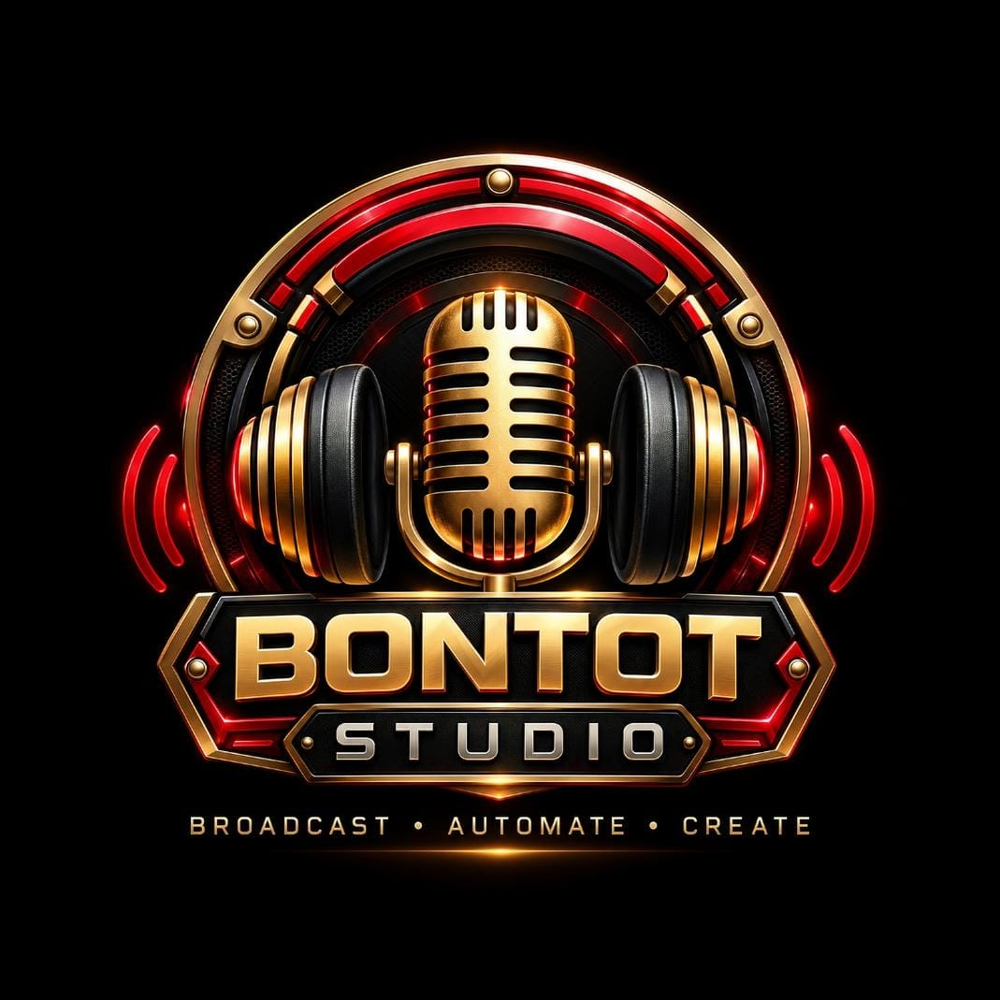

# TBR DIGITAL MIXER
### Professional Windows Audio Mixing Software for Broadcast, Radio Streaming, Podcast, Vocal Processing & Music Playback



Official Repository: [https://github.com/thebontotradio-on/TBR-DigitalMixer](https://github.com/thebontotradio-on/TBR-DigitalMixer)  
Developed for: **The Bontot Radio Audio Engineering Network**  
Platform: **Windows 10 / 11 (x64)**

---

## 🌟 Overview

**TBR DIGITAL MIXER** is a professional dark audio workstation designed from the ground up for high-fidelity audio processing. It features a complete 11-channel digital mixing console, 18 dedicated broadcast vocal presets, 40 professional music mastering presets (including the iconic Indonesian **TBR HOREG** sound system curve), real-time phase correlation, true-peak lookahead limiting (-0.3 dBFS anti-clipping), and ITU-R BS.1770 LUFS loudness metering.

---

## 🎛️ Key Features

- **11-Channel Workstation Console:**
  - 5 Audio Inputs: `Vocal`, `Music`, `Guest`, `TTS`, `Chat`
  - 1 Group Bus: `Group Master`
  - 4 Aux Send Buses: `Chorus`, `Delay`, `Reverb`, `Harmonizer`
  - 1 Master Output Strip: `Master` with Brickwall Limiter
- **Dual Stereo LED Ladder Meters:** Real-time peak, RMS, peak hold, and red clip warning LEDs.
- **Dedicated Vocal Studio:**
  - 18 actual DSP presets across Broadcast & Radio, Natural & Warm, and Advanced Vocal.
  - High-Pass Filter (HPF), Studio Noise Gate, 8-Band Interactive Parametric EQ, Broadcast De-Esser, Optical/VCA Compressor, Analog Warmth, and Voice Limiter.
  - Real-time FFT Frequency Spectrum Analyzer.
  - A/B instant preset audition comparison.
- **Dedicated Music Master Studio:**
  - 40 actual DSP presets across General Music, Bass & Wide Sound, Horeg & Party Sound, Music Genres, and Listener Comfort.
  - Sub-Bass Harmonic Synthesizer (Horeg Exciter) for deep chest-thumping bass without speaker distortion.
  - Stereo Imager with Low-Frequency Mono Bass Centering (prevents phase cancellation).
  - 3-Band Master Dynamics and True-Peak Brickwall Limiter.
  - Phase Correlation Meter & ITU-R BS.1770 LUFS Loudness Meter (Momentary, Short-Term, Integrated).
- **Sound Pads:** 16-pad soundboard trigger rack for jingles and sound effects.
- **Preset Management:** Search, category filters, favorite presets, custom preset saving, JSON export/import.
- **Hardware Routing:** Compatible with standard Windows Audio, WASAPI, VB-Audio Virtual Cable (VB-CABLE), Voicemeeter, USB microphones, and headsets.
- **Built-in Diagnostic Signal Generator:** Sine 1kHz, Pink Noise, Sine Sweep, Human Speech Formant simulation, and Groove Beat generator.

---

## 🚀 Running & Developing

### Prerequisites:
- Node.js v18+ (tested on Node v24)
- npm v10+

### Development Mode:
```bash
# Install dependencies
npm install

# Run automated DSP & preset test suite
npm test

# Launch desktop application
npm start
```

### Building Release Packages:
```bash
# Build unpacked Windows directory
npm run pack

# Build standalone portable Windows executable
npm run dist
```
The output executable will be created in `release-dist/TBR-Digital-Mixer-1.0.0-windows-x64.exe`.

---

## 📋 Full Forensic Audit Report
For the complete technical audit, DSP mathematical verification, and preset parameters, read [TBR_DIGITAL_MIXER_FULL_AUDIT_REPORT.md](TBR_DIGITAL_MIXER_FULL_AUDIT_REPORT.md).

---

## 📄 License
Copyright © 2026 The Bontot Radio Audio Engineering Network. All rights reserved.
